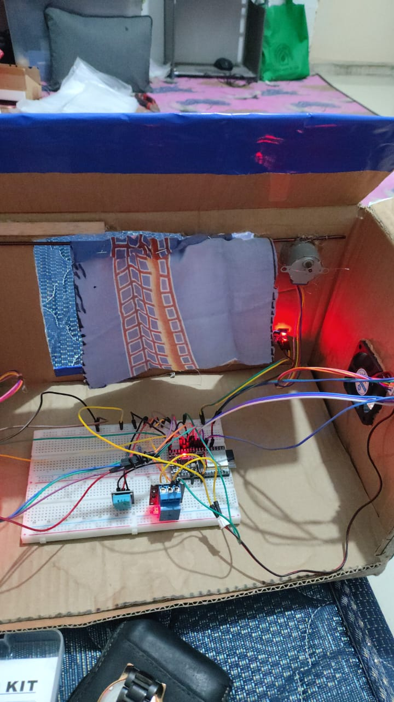

# Smart Curtain IoT

An ESP32 room model that opens a curtain by light level, switches a fan by temperature, and publishes its status over MQTT. Built in October 2024.

## Overview

| | |
|---|---|
| **Controller** | ESP32 |
| **Sensors** | DHT11 temperature and humidity, LDR light sensor |
| **Actuators** | 2 stepper motors for the curtain, relay for the fan |
| **Communication** | Wi-Fi, MQTT on port 1883 |

## Control logic

| Condition | Action |
|---|---|
| LDR reading above 2000 | Open the curtain |
| LDR reading at or below 1000 | Close the curtain |
| Temperature above 34 °C | Turn the fan relay on |

## MQTT topics

| Topic | Data |
|---|---|
| `sensor/temperature` | Temperature |
| `sensor/humidity` | Humidity |
| `sensor/ldr` | Light reading |
| `relay/status` | Fan relay state |
| `tirai/status` | Curtain state |

The device also subscribes to `/esp32/mqtt/in` and prints incoming messages to the serial monitor.

## Run it

Open `firmware/smart_curtain_mqtt` in Arduino IDE with the ESP32 board package and the DHT, Stepper and PubSubClient libraries. Set `ssid` and `password`, then upload.

## Repository contents

| Path | Contents |
|---|---|
| `firmware/smart_curtain_mqtt/` | Full version with Wi-Fi and MQTT |
| `firmware/smart_curtain_offline/` | Version without Wi-Fi and MQTT |
| `images/` | Prototype photo |
